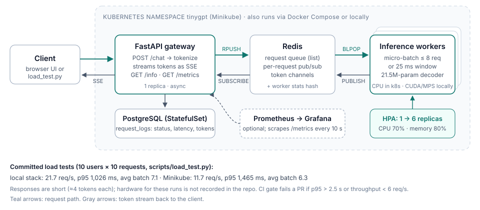

## How it works

The data comes from a generator that writes `CLIENT:`/`OUTPUT:` conversations. In each one, people receive objects ("Bob receives the hat."), pass them around ("Eve takes the ring from Alice."), receive countable items ("Diana has 8 apples.") and ask questions. A `PossessionState` object tracks the true state, so every answer is correct by construction. There are 11 question types: who has X, what does X have, yes/no, who has what, how many, who does not have X, does anyone have X, comparisons, who has apples, how many apples, and who has the most. Training used 300k conversations (seed 42). The vocabulary is a closed set of 148 tokens with whitespace and punctuation tokenization, which keeps the model's capacity on state tracking rather than spelling.

The model is a GPT-style pre-norm decoder: 12 layers, d_model 384, 12 heads, FFN 1536, learned absolute positions up to 384 tokens, and an output head tied to the token embeddings, for 21.5M parameters. Loss covers only the model's own turns (the `OUTPUT:` tokens). Training ran on an A100 with bf16, TF32, FlashAttention through SDPA, and `torch.compile`. The best checkpoint came at epoch 16 with a validation loss of 4.2e-4.

For serving, a FastAPI gateway tokenizes the conversation and pushes it onto a Redis list. Workers block on that list, collect up to 8 requests or wait 25 ms, run batched decoding and publish each token to a per-request pub/sub channel. The gateway streams those tokens to the client as server-sent events. The same stack runs locally, under Docker Compose, or on Minikube, with a worker HPA and optional Prometheus and Grafana.



## Results

All results were measured with the committed `checkpoints/best.pt` on an Apple M3 Max CPU. The test split is the repo generator's own (`--test 2000`, seed 456); 3 of its 2,000 conversations also appear verbatim in the 300k training set. Each answer is decoded greedily given the true conversation so far and scored by exact token match.

| Slice | Correct |
|---|---|
| All questions | 4,370 / 4,388 (99.6%) |
| Who has the X? | 1,599 / 1,599 (100%) |
| Who has what? (full inventory) | 281 / 285 (98.6%) |
| Who has the most apples/oranges/coins? | 98 / 102 (96.1%) |
| How many apples does X have? | 445 / 449 (99.1%) |
| Whole conversations with every turn correct | 1,985 / 2,000 (99.3%) |

Accuracy stays between 99.2% and 100% however many statements come before the question (conversations run up to 29 turns).

**Where it breaks.** In the stress test, one object is passed k times before the question. Accuracy is ≥99% for k ≤ 6, which covers 99.98% of training conversations. It then falls to 81% at k = 10 and about 34% at k = 20. Those longer conversations (≤ 284 tokens) are shorter than the longest test conversations (362 tokens), which the model handles, so the failure is in the depth of the state chain, not in context length.

The repo's 22 scripted conversations (`run_examples.py`) all pass (22/22).

## Try it

```bash
python data_generator.py --train 300000 --val 2000 --test 2000 --outdir data
python run_examples.py        # 22 scripted conversations against checkpoints/best.pt
```
