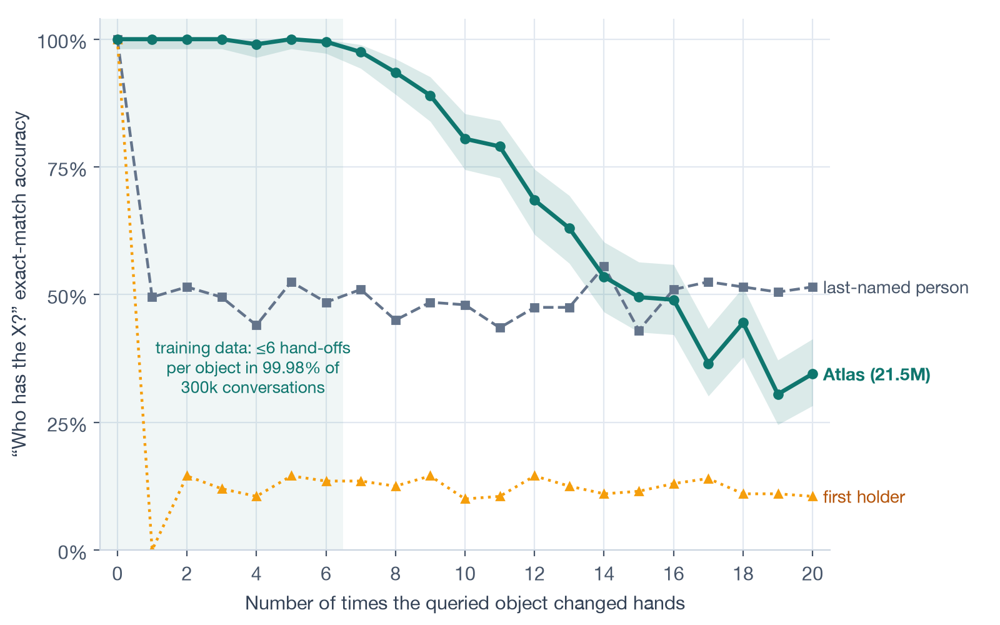

## Example

Real output from the trained model.

```
> Alice receives the ring.               Got it.
> Bob receives the key.                  Got it.
> Bob has 5 apples.                      Got it.
> Diana takes the ring from Alice.       Got it.
> Bob gives 2 apples to Alice.           Got it.
> Who has the ring?                      Diana has the ring.
> How many apples does Bob have?         Three.
> Who has what?                          Alice has two apples. Bob has three
                                         apples and the key. Diana has the ring.
```

## Results

Held-out test set of 2,000 conversations, exact match.

| question | accuracy |
|---|---|
| all 4,388 questions | 99.6% |
| who has the X? | 100% |
| who has what? | 98.6% |
| how many apples does X have? | 99.1% |
| every turn in a conversation correct | 99.3% |



It stays at or above 99% up to 6 hand-offs, the most seen in training, then falls to 34% at 20.

## Model

```
12-layer decoder · d_model 384 · 12 heads · 148-token vocabulary
300k synthetic conversations, 11 question types
A100 · bf16 · FlashAttention · torch.compile
```

## Serving

```
client → FastAPI → Redis queue → workers → tokens streamed back over SSE
```

Workers batch up to 8 requests, waiting at most 25 ms, and autoscale from 1 to 6 on Kubernetes. Every pull request runs a load test that fails if p95 latency goes over 2.5 s.
