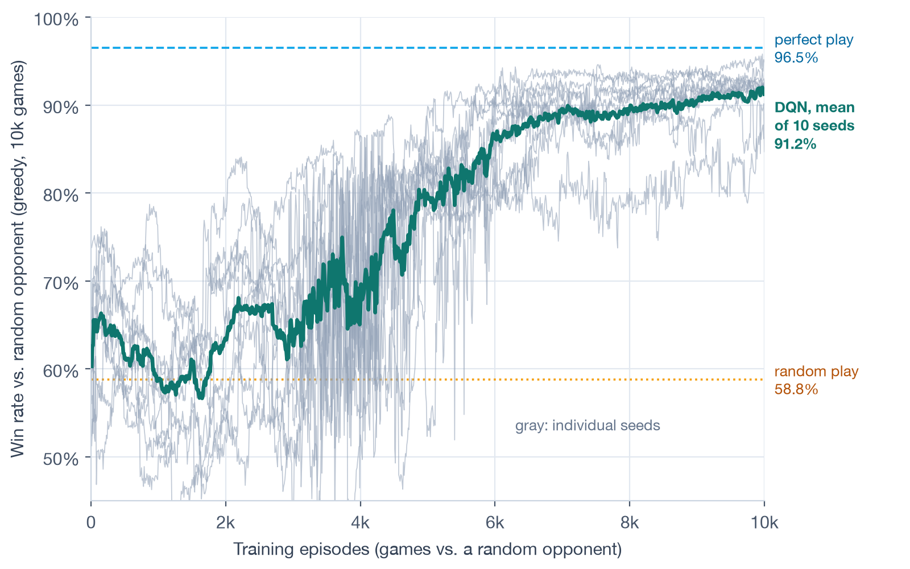

## Example

Training an MLP on Iris, from the repo.

```
ml::Sequential model;
model.add_layer(std::make_shared<ml::LinearLayer>(4, 32));
model.add_layer(std::make_shared<ml::ReLULayer>());
model.add_layer(std::make_shared<ml::LinearLayer>(32, 32));
model.add_layer(std::make_shared<ml::ReLULayer>());
model.add_layer(std::make_shared<ml::LinearLayer>(32, 3));

ml::NN_SGD optimizer(model.parameters(), 0.01f, batch_size);

for (std::size_t i = 0; i < epochs; ++i) {
    optimizer.zero_grad();
    ml::parallel_backpropagate_batch(model, batch,
        [&](ml::Sequential &m, const Matrix &x, std::size_t j) {
            Matrix logits = m.forward(x);
            m.backward(softmax(logits) - one_hot_encode(labels(0, j), 3));
        });
    optimizer.step();
}
```

The same loop runs data-parallel across processes by swapping in `distributed_parallel_backpropagate_batch`, which all-reduces gradients over TCP.

## Results

| task | result |
|---|---|
| DQN vs. random tic-tac-toe opponent, 10 seeds | 91.2% wins (random play 58.8%, perfect play 96.5%) |
| MLP on Iris, 20 random splits | 95.7% |
| 2 processes over TCP vs. 1 process, same task | 95.2% vs. 94.9% |



## What's in it

```
linear algebra    Matrix with multithreaded kernels, LP and QP solvers, symbolic differentiation
neural networks   Linear, ReLU, Sigmoid, Tanh · SGD, Adam, AdamW, RMSProp, Adagrad
classical ML      kernel SVM, random-feature SVM, naive Bayes, kNN, PCA, k-means, logistic regression
RL                DQN with replay and a target network, REINFORCE, ε-greedy and UCB bandits
distributed       TCP process group: broadcast, barrier, all-reduce, checkpoint and resume
bindings          Python, through a C API
```

The library has no dependencies beyond the C++ standard library. 52 unit tests run in CI on Ubuntu and macOS.
