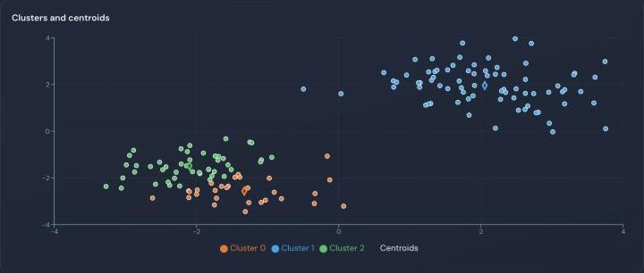

## Labs

| area | methods |
|---|---|
| stochastic processes | SDE sample paths (Euler–Maruyama) beside the Fokker–Planck density; Markov chains; CTMCs via the matrix exponential |
| optimization | Big-M simplex with pivot history; active-set quadratic programming; gradient descent with momentum |
| learning | SVM trained with SMO (linear, RBF, polynomial kernels); decision trees, bagging, boosting; kNN; logistic regression; k-means, DBSCAN, PCA |
| linear algebra | LU, QR, Cholesky, SVD; Ax = b for any m×n system |
| reinforcement learning | ε-greedy, UCB and Thompson sampling bandits; value iteration, Q-learning and SARSA on grid worlds |
| probability | law of large numbers, central limit theorem, concentration inequalities against empirical tails |
| physics | damped pendulum (RK4); heat equation in 1D, 2D and 3D |

Every solver is written from scratch in TypeScript, with no math library, and runs client-side.
