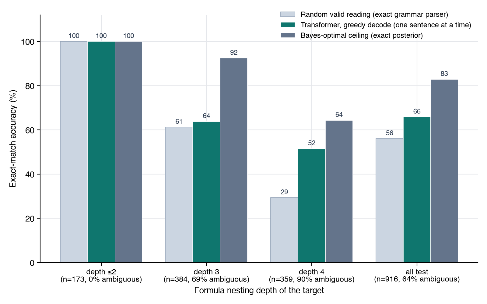

## Example

Real outputs from the trained model on held-out sentences.

```
if both C holds and B holds then A holds if and only if D is true
→ IMPLIES(AND(C,B),IFF(A,D))

provided that B is true, D holds is equivalent to C is true
→ IMPLIES(B,IFF(D,C))

A is true together with if A is true then B is true is false
→ AND(A,IMPLIES(A,NOT(B)))

B holds together with D holds is false
→ AND(B,NOT(D))          the test set says NOT(AND(B,D)); both fit the sentence
```

## Results

Exact match on 916 held-out sentences. The English has no brackets, so 64% of them have more than one valid reading.

| predictor | exact match |
|---|---|
| a random valid reading | 56.1% |
| this model | 65.8% |
| best possible, from the exact posterior | 83% |



The model is perfect on every sentence up to depth 2, and 81% of all its outputs are a valid reading of the input.

## Model

```
encoder-decoder transformer · 4 + 4 layers · d_model 256 · 8 heads · 7.4M parameters
43-token English vocabulary, 17-token logic vocabulary, output in prefix form
9,148 training pairs: random formulas over A–E up to depth 4, written out with 23 English templates
```
