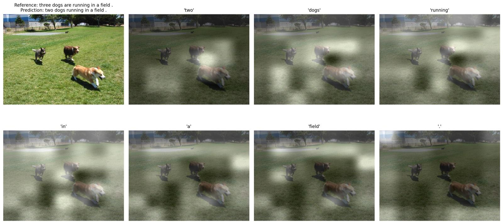

## Results

METEOR on the Flickr8k test split.

| model | paper | ours |
|---|---|---|
| soft attention | 18.93 | 18.96 |
| hard attention | 20.30 | 20.75 |

## Example

Where the soft-attention model looks for each word it generates.



## Model

```
ResNet-50 (replaces VGG-19) → 14×14 grid, 196 regions → LSTM decoder, additive attention
soft attention   Adam, teacher forcing decayed 1.0 → 0.5
hard attention   fine-tuned from soft for 20 epochs with REINFORCE
decoding         beam search, width 8
training         about 24 h on one T4
```
